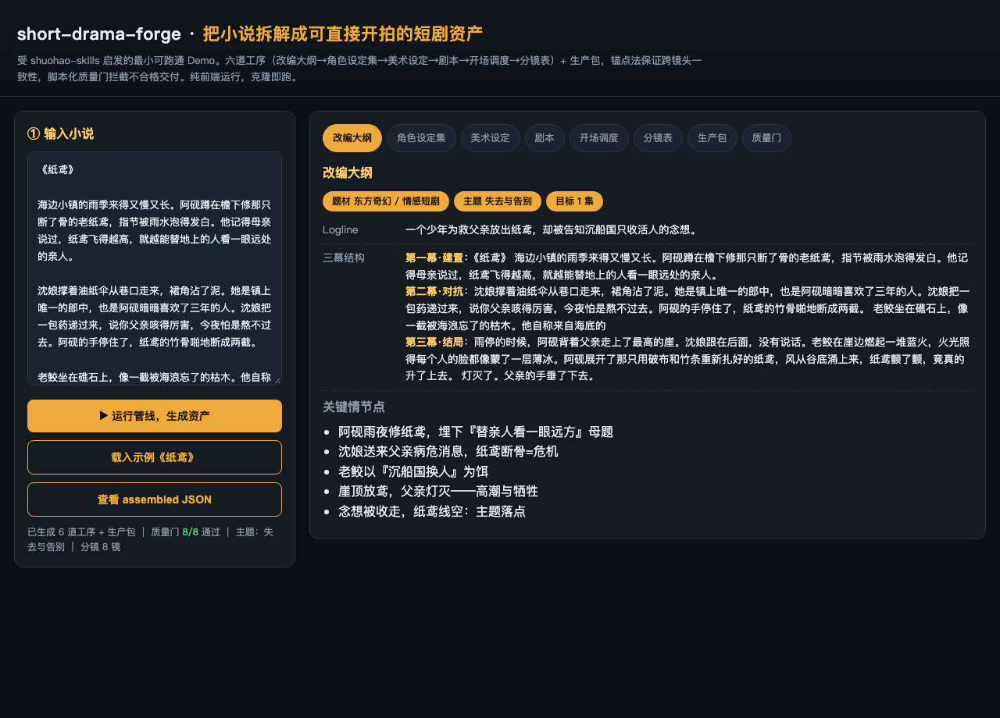
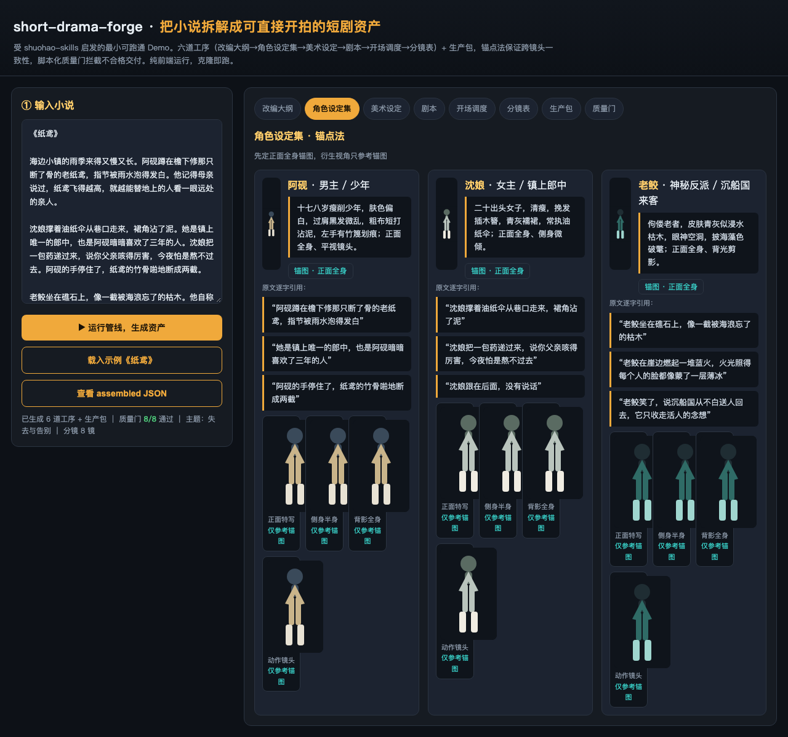
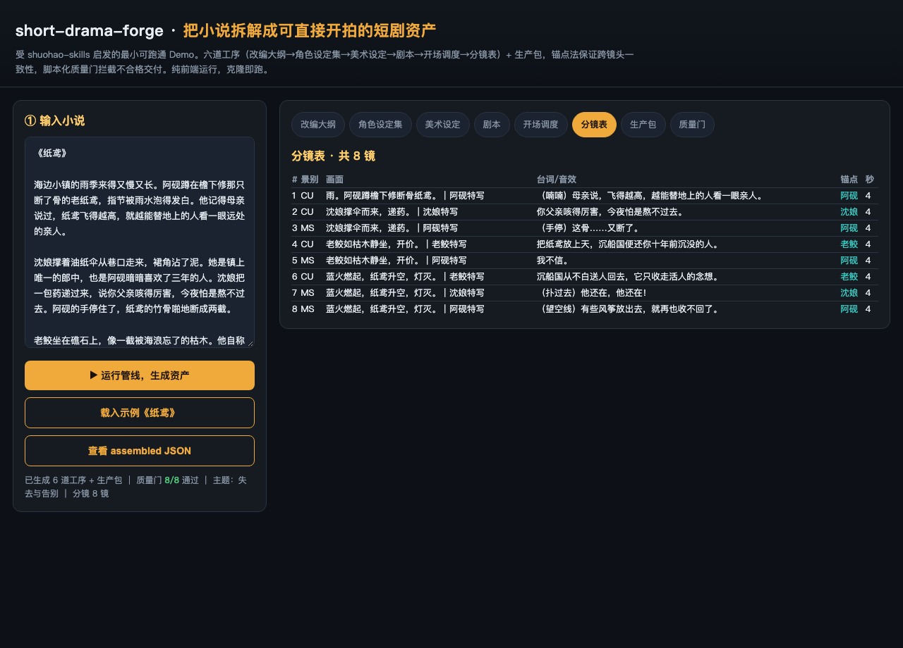
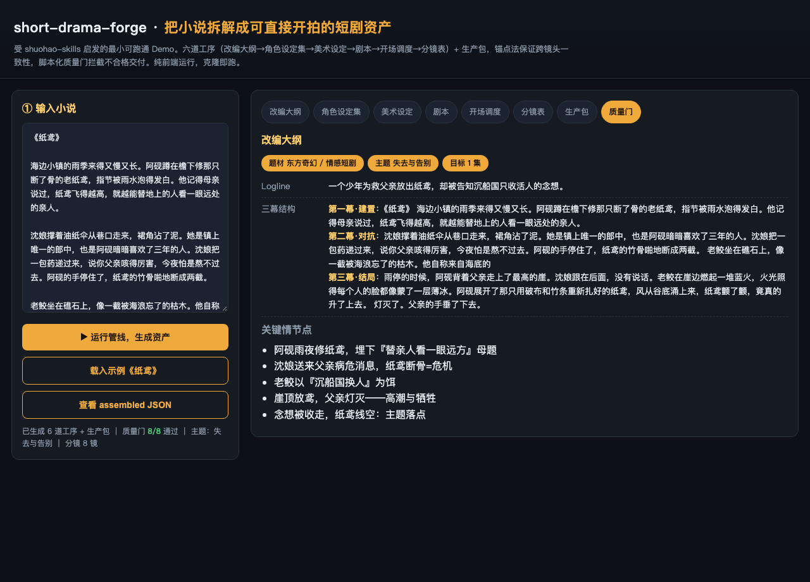
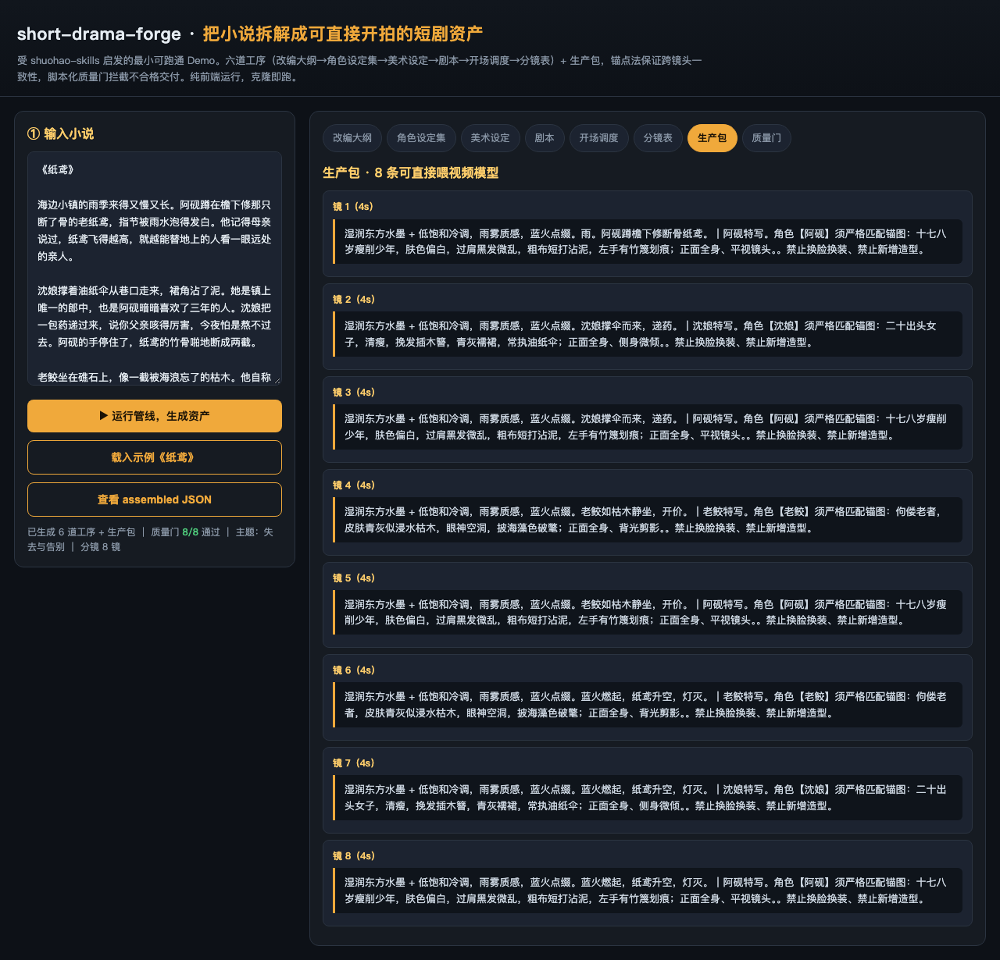

# short-drama-forge

> 把小说拆解成可直接开拍的短剧资产 · 受 [shuohao-skills](https://github.com/eternityspring/shuohao-skills) 启发的最小可跑通 Demo

把一个小说丢进去，自动产出**改编大纲 → 角色设定集 → 美术设定 → 剧本 → 开场调度 → 分镜表**，外加可直接喂给视频模型的**生产包**。覆盖从小说到开拍的六道工序，并用**锚点法**解决跨镜头「换脸换装」一致性，用**脚本化质量门**拦截不合格交付。

本仓库是 shuohao-skills 思路的**最小演示实现**：用确定性模板跑通同一套「JSON 交接 + 锚点锁定 + 质量门」协议，证明「克隆安装即跑、一人团队低成本做 AI 短剧」的链路可行。真实 shuohao-skills 由 LLM 驱动各工序、内置约 60 道质量门、上线两个半月获 5500+ star。

---

## 操作截图（本项目实际运行）

**① 总览 · 输入小说 → 一键生成六道工序资产**



**② 角色设定集 · 锚点法（先定正面全身锚图，衍生视角只参考锚图）**



**③ 分镜表 · 每个镜头都引用角色锚点，保证一致性**



**④ 质量门 · 8 道代表性门全绿（真实项目约 60 道）**



**⑤ 生产包 · 每条都是可直接喂视频模型的 prompt（含锚图约束 + 视觉风格）**



---

## 它能解决什么

| 痛点 | 解法 |
|------|------|
| 人物跨镜头换脸换装不一致 | **锚点法**：先确认一张正面全身锚图，其余视角一律只参考锚图生成 |
| 各工序靠人工在不同工具间复制粘贴 | 各阶段以 **JSON 文件交接**，角色 / 美术 / 剧本三者联动迭代 |
| AI 瞎编、交付不可信 | **脚本化质量门**：不合格打回；角色画像每条结论必须附**原文逐字引用** |
| 一人团队成本高 | 全套克隆安装即跑，零外部依赖 |

---

## 六道工序 + 生产包

```
小说全文
   │
   ├─① outline      改编大纲       → 题材 / 主题 / 三幕 / 情节点
   ├─② character    角色设定集     → 角色画像 + 锚图 + 逐字引用   ★ 锚点法核心
   ├─③ art          美术设定       → 视觉风格 / 色板 / 场景 / 锚点锁定
   ├─④ script       剧本           → 分集场景 + 台词 + 动作
   ├─⑤ blocking     开场调度       → 机位 / 走位 / 连续性
   ├─⑥ storyboard   分镜表         → 镜头列表（景别 / 画面 / 台词 / 锚点）
   │
   └─⑦ production-pack 生产包      → 可直接喂视频模型的 prompt（锚图约束 + 视觉风格）
```

各阶段以 JSON 在 `output/` 目录交接，下游 skill 读取上游指定字段
（如 `storyboard.anchor_ref` 读 `characters`，`production_pack` 读 `art.visual_style`）。

---

## 两种跑法

### A. 网页交互（零安装，推荐先看效果）

直接用浏览器打开 `index.html`，或本地起一个静态服务：

```bash
cd short-drama-forge
python3 -m http.server 8000
# 打开 http://localhost:8000/index.html
```

页面左侧粘贴你的小说（已预载示例《纸鸢》），点「运行管线」即可看到六道工序结果；
顶部标签可切换各工序，URL 支持 `#outline #characters #art #script #blocking #storyboard #pack #gates` 深链。

### B. 命令行 / 克隆安装即跑

```bash
pip install -U pip   # 无需任何第三方依赖，仅用 Python 标准库
python3 pipeline.py                 # 跑内置示例《纸鸢》
python3 pipeline.py 你的小说.txt     # 跑你自己的文本
```

运行后会在 `output/` 生成 8 个 JSON（`outline / characters / art / script / blocking / storyboard / production_pack / quality_gates`）
外加 `_summary.txt` 质量门报告：

```
▶ 质量门：8/8 通过
    [✔] G01 主角锚图含『正面全身』描述
    [✔] G02 衍生视角声明『仅参考锚图』
    ...
▶ 主题： 失去与告别
▶ 主角： 阿砚、沈娘、老鲛
▶ 分镜镜头数： 8
▶ 生产包 prompt 数： 8
```

---

## 质量门（Quality Gate）

真实 shuohao-skills 内置约 60 道脚本化质量门，AI 交付不合格即打回。
本 Demo 实现 8 道代表性门（`quality_gates.json` / 页面「质量门」标签）：

- G01 主角锚图含『正面全身』描述
- G02 衍生视角声明『仅参考锚图』
- G03 角色画像含原文逐字引用
- G04 剧本场景数 ≥ 3 且含冲突推进
- G05 分镜每个镜头引用角色锚点
- G06 生产包 prompt 含视觉风格
- G07 美术设定锁定全部角色锚点
- G08 六道工序 + 生产包 JSON 字段完整

---

## 目录结构

```
short-drama-forge/
├── index.html            # 交互式 Demo（六道工序 + 锚点法 + 质量门可视化）
├── pipeline.py           # 可离线运行的管线（标准库，生成 JSON 资产 + 质量门）
├── SKILLS.md             # 一整套短剧前期制作 Skill 说明（工序/锚点法/质量门/交接协议）
├── samples/
│   └── novel_excerpt.txt # 示例小说《纸鸢》（原创，480 字）
├── output/               # pipeline.py 生成产物（JSON + 报告）
├── assets/               # README 操作截图
└── LICENSE               # MIT
```

---

## 与 shuohao-skills 的关系

| 维度 | shuohao-skills（原项目） | 本 Demo |
|------|--------------------------|---------|
| 驱动方式 | LLM 驱动各 skill | 确定性模板演示协议 |
| 质量门 | ~60 道 | 8 道代表性 |
| 锚点法 | 真实图生图 | 锚图规格 + 约束传递 |
| 依赖 | 需模型调用 | 零依赖，标准库 |
| 定位 | 生产级开源项目 | 教学 / 验证链路的最小实现 |

> 本仓库仅为思路演示与学习用途；正式生产请使用上游 [shuohao-skills](https://github.com/eternityspring/shuohao-skills)。

## License

MIT © clawgeek
